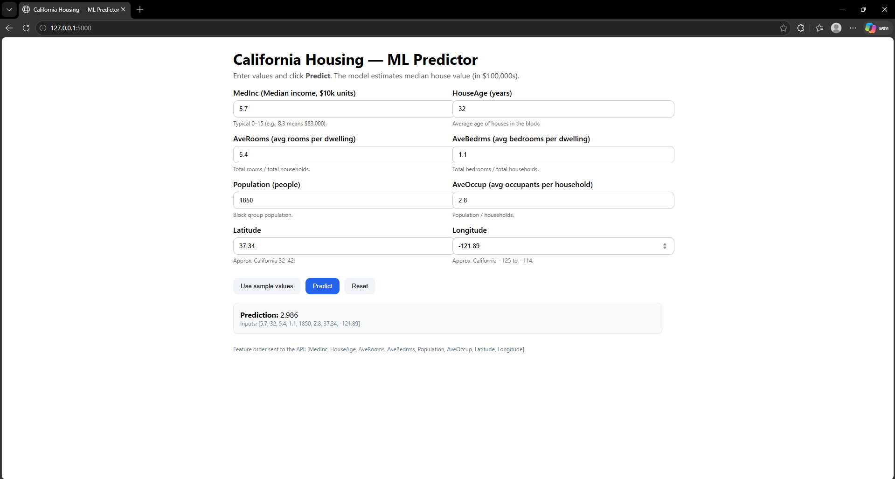

# ML Service - California Housing

Lab CPE312 ทำ Model as a Service ด้วย Flask + Docker

พชร สุขหน้าไม้ 67109010192

โมเดลเป็น RandomForest ทำนายราคาบ้านใน California (หน่วยเป็น $100,000) ทำเป็นเว็บด้วย Flask แล้วรันใน Docker

## ไฟล์ในโปรเจกต์

- `train_model.py` เทรนโมเดลแล้วเซฟเป็น `model/model.pkl`
- `app.py` ตัว Flask มีหน้าเว็บ `/` , API `/predict` และ `/health`
- `templates/main.html` หน้าเว็บกรอกค่า
- `requirements.txt` ไลบรารีที่ใช้
- `Dockerfile` ไว้ build image

## วิธี build และ run

**1. ติดตั้ง Docker Desktop** แล้วเปิดไว้ (มุมล่างซ้ายต้องขึ้น Engine running)

**2. เข้าไปในโฟลเดอร์โปรเจกต์** แล้วเปิด terminal

**3. Build image**

`docker build -t ds-ml-service .`

ตอน build มันจะลง library ตาม requirements.txt แล้วรัน train_model.py ให้เลยไม่ต้องเทรนเอง ครั้งแรกอาจรอนานหน่อย ของผมรอประมาณ 1 นาที

**4. Run container**

`docker run --rm -p 5000:5000 ds-ml-service`

ถ้าขึ้น `Listening at: http://0.0.0.0:5000` แปลว่าใช้ได้แล้ว

**5. เปิดเว็บ**

- หน้าเว็บ http://127.0.0.1:5000/
- เช็กสถานะ http://127.0.0.1:5000/health

**6. รันใน PowerShell**

`Invoke-RestMethod -Uri http://127.0.0.1:5000/predict -Method Post -ContentType "application/json" -Body '{"features":[8.3,25.0,6.0,1.0,1200,3.0,34.2,-118.3]}'`

ควรได้ค่าประมาณ 4.029 และปิดเซิร์ฟเวอร์ด้วย Ctrl + C

## ผลลัพธ์

ลองใส่ค่าเอง ได้ 2.986

ใช้ค่าตัวอย่าง (Use sample values) ได้ 4.029 ตรงกับที่อาจารย์บอก

